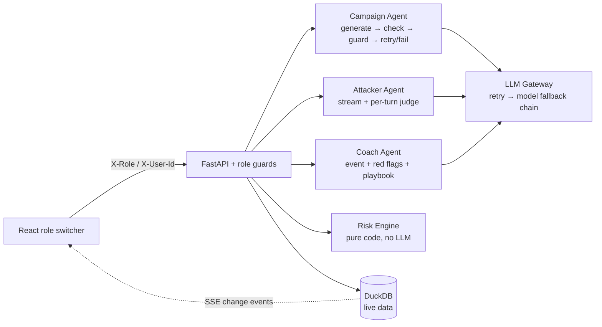

# PhishCoach AI

### Stop measuring who clicked. Start teaching them not to.

Every quarter, enterprises send a phishing simulation, count the clicks, and send a PDF.
The employee who failed learns nothing. The security team burns weeks. The next campaign looks the same.

**PhishCoach AI closes the loop.** An AI red team writes the phish, plays the attacker live, coaches the employee *at the exact moment they slip*, and proves, with a treatment-vs-control experiment, that risk is going down.

> **10-second demo:** Admin generates a campaign → Employee clicks the phish → coaching streams back instantly → Admin's risk dashboard moves in real time → HR sees anonymised aggregates only; every forbidden route returns `403`.

---

## The problem

| Today | Cost |
|---|---|
| Static, same-for-everyone phishing templates | Employees learn to spot *the template*, not the attack |
| Failing a simulation → generic "you clicked" page | The teachable moment is wasted |
| Campaigns hand-built and hand-deployed | Security teams spend time on logistics, not risk |
| No per-person progress or risk view | Remediation is guesswork |
| Nobody can prove training works | Compliance becomes a checkbox |

## The solution

| Capability | How |
|---|---|
| **Dynamic phishing generation** | Tailored to department, role and difficulty; every email carries a labelled set of red flags |
| **Live attacker simulation** | A conversational agent plays the social engineer; a judge scores every turn |
| **Instant personalised coaching** | Feedback cites wording from *that* email and *that* employee's action |
| **Risk and remediation** | Config-driven risk scores feed a high-risk queue admins launch from in one click |
| **Proof of impact** | Control arm gets standard guidance; treatment gets the AI coach; difference-in-differences on click rate |
| **Integrations** | HR system sync (roles, departments) and simulation-platform webhooks, behind swappable adapters |

---

## Agentic design



| Agent | Job | Why it is trustworthy |
|---|---|---|
| **Campaign** (LangGraph) | Brief → phishing email JSON | Schema validation → deterministic rule check (no real brands, reserved domains only, no forms) → second-model safety review → bounded retries. Fails closed. A human approves before anything is deployed. |
| **Attacker** | Plays the phisher in chat | Every turn judged (spotted / fell for it / turn cap); output filtered token by token; prompt-injection patterns blocked. |
| **Coach** | Turns a real click/submit/report into guidance | Grounded in the employee's actual event, the email's planted flags and the playbook. Never generic. |
| **Risk Engine** | Scores and bands each employee | Plain code with thresholds in the database. No LLM in the loop that decides who gets remediated. |

Full diagram, role matrix and failure table: [ARCHITECTURE.md](ARCHITECTURE.md).

---

## How it scores on what matters

### 1. Real-world usefulness
Closes the gap from *sent* to *learned*: generation, live practice, coaching, remediation, and an experiment design that produces defensible evidence. HR sees department aggregates only, and small cohorts are suppressed (min cohort size 5). Employees are shown as anonymised IDs (`emp_xxxx`).

### 2. Agent design
Four purpose-built agents with narrow jobs, typed outputs, validators between steps and a human approval gate. Deterministic code handles the decisions that affect people. See [ARCHITECTURE.md](ARCHITECTURE.md).

### 3. Unbreakability
Failures are expected, so each has a defined response:

| Failure | Response |
|---|---|
| Model rate-limited, erroring or empty | Bounded retry with backoff → automatic next model in the chain; header badge flags fallback |
| **Every model down** | **Coaching degrades to a rules coach** built from the employee's real event, the email's flags and playbook rows, labelled *"rules coach (AI offline)"*. No employee is left without feedback. |
| Model emits unsafe or malformed email | Rule check + guard model reject it; regenerate; on the last attempt ship only the red flags that can be verified; otherwise a clear error |
| Prompt injection in chat | Blocked and explained; session continues |
| Employee requests admin or HR data | Server-side `403`, not just hidden UI |
| Event stream drops | Client reconnects with exponential backoff |
| Unhandled generation error | Structured JSON error the UI can display |

The only fallbacks are for the LLM itself. All data is live: no mock or static data is served to the UI.

### 4. Demo and clarity
No login screens. A role switcher changes the view *and* the server-side permissions at once. Each role opens with a one-line goal and a three-step journey. Dashboards update live over SSE.

---

## Evals and tests

| Layer | What it proves |
|---|---|
| Unit | Risk scoring, guardrails, anonymisation, rules-coach grounding |
| Integration | Campaign → deploy → inbox → events → coaching → export, with cross-user and cross-role access attempts; **LLM-down coaching fallback** |
| Safety | Prompt-injection and unsafe-content blocking |
| Live LLM eval (opt-in) | Real model output must pass the production guardrails (`pytest tests/llm_eval`, needs `GROQ_API_KEY`) |
| CI | Ruff lint, test suites and frontend build on every push |

```bash
pytest tests/unit tests/integration tests/safety -q
```

**Pilot metrics** the Impact tab reports: click rate, report rate and median time-to-report per arm and wave, plus the difference-in-differences. The pilot cohort is small and synthetic, so results are indicative, not conclusive, and the app says so.

---

## Privacy and ethics
Synthetic employees for development · anonymised IDs in every UI · HR sees aggregates only · k-anonymity suppression · non-punitive coaching tone · reserved domains only, never real brands · no model training anywhere · secrets are backend-only.

## Stack
React + Vite + Tailwind + Recharts · FastAPI + SSE · LangGraph · Groq-hosted open models (`gpt-oss`) with fallback chain · DuckDB.

## Run it

```bash
python -m venv .venv && .venv\Scripts\activate        # macOS/Linux: source .venv/bin/activate
pip install -r backend/requirements.txt
cp .env.example .env                                   # add GROQ_API_KEY, JWT_SECRET, SIM_WEBHOOK_SECRET

uvicorn mock_systems.mock_hr.app:app  --port 8001      # HR system stand-in
uvicorn mock_systems.mock_sim.app:app --port 8002      # simulation platform stand-in
python tools/sync_hr.py && python tools/create_demo_users.py && python tools/ingest_kb.py
uvicorn app.main:app --app-dir backend --port 8000

cd frontend && npm install && npm run dev              # http://localhost:5173
```

## Production note
The role switcher and `X-Role` header are demo-only by design (no login screens). In production, replace the single `get_current_user` dependency with SSO/JWT; every endpoint already depends on it.

## Repo map
`backend/app/agents` agents · `backend/app/services` gateway, guardrails, risk · `backend/app/api` routes · `frontend/src` UI · `mock_systems` HR and simulation platform stand-ins · `content/playbook` red-flag taxonomy · `tests` unit, integration, safety, live eval · `docs` spec, audit, user manual
