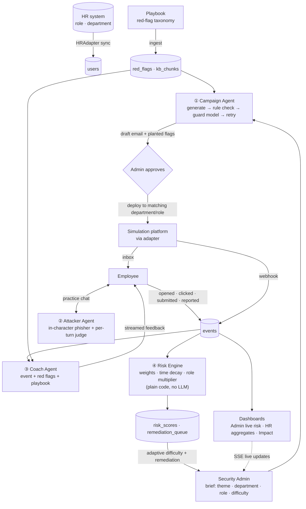

# PhishCoach AI

### Finance gets invoice fraud. HR gets fake résumés. Sales gets fake deal-room links. Your training sends them all the same email.

PhishCoach AI is an AI red team for the enterprise. It writes phishing simulations **in the language of each department**, plays the attacker live, coaches each employee **at the moment they slip**, and proves with a control group that risk is falling.

---

## The gap in enterprises today

Enterprises already run quarterly simulations. The programme exists; the learning doesn't.

| What happens today | Why it fails |
|---|---|
| One generic template ("reset your password") goes to everyone | Attackers don't work that way. They target the **work each person actually does**. |
| Finance, HR, Sales, Engineering and IT face different threats every day | Generic phish trains people to spot *the template*, not *their* real attack |
| A failed click lands on a generic "you've been phished" page | The most teachable moment of the quarter is wasted |
| Campaigns are designed and deployed by hand | Security teams spend weeks on logistics, not risk |
| Results arrive as post-campaign metrics | No per-person progress, no targeted remediation |
| Nobody can show training *changed* behaviour | Compliance becomes a checkbox |

### Why personalisation by department is the unlock

| Department | A realistic attack on them | Generic template covers it? |
|---|---|---|
| **Finance** | Urgent vendor invoice / changed bank details | No |
| **HR** | Résumé attachment, payroll or benefits update | No |
| **Sales** | Prospect "deal room" link, forged contract | No |
| **Engineering / IT** | Fake access request, repo or admin alert | No |
| **Operations** | Supplier delivery change, facilities notice | No |

People notice what feels like their own inbox. A phish that mirrors your day is the one you'll actually remember, and the one you'll report next time. PhishCoach AI generates that email for every department and role, then **adapts difficulty per person** from their history.

---

## What it does

| Capability | How |
|---|---|
| **Department- and role-tailored phishing** | Generated from a brief (theme, department, role, difficulty), each email carrying a labelled set of red flags |
| **Live attacker chat** | A conversational agent plays the social engineer; a judge scores every turn |
| **Instant personal coaching** | Feedback quotes wording from *that* email and reflects *that* employee's action |
| **Risk and remediation** | Per-person risk bands drive a high-risk queue admins launch from in one click |
| **Proof of impact** | Treatment arm gets the AI coach, control arm gets standard guidance, then difference-in-differences on click rate |
| **Enterprise integration** | HR system sync (role, department) and simulation-platform webhooks behind swappable adapters |

---

## Agentic design

### End-to-end flow



### The four agents

| # | Agent | Input | Output | Safeguards |
|---|---|---|---|---|
| ① | **Campaign** (LangGraph) | Admin brief + selected red flags from the playbook | Email JSON: sender, subject, body, link, `planted_flags` | **Brief intake gate** (rules + guard-model intent check; rejects off-topic, real-brand, real-URL, injection or unknown-team briefs with a `422` and audit entry) → Schema validation → deterministic rules (no real brands, reserved domains only, no forms) → second-model safety review → bounded retries → human approval before deploy |
| ② | **Attacker** | Employee role and department, conversation so far | In-character phishing turns, streamed; verdict per turn (spotted / fell for it / turn cap) and a debrief | Prompt-injection patterns blocked, output filtered token by token, turn cap |
| ③ | **Coach** | The employee's *real* action, the email, its planted flags, matching playbook rows | Short, supportive, specific feedback, streamed | Non-punitive tone, grounded in real event; falls back to a rules coach if every model is down |
| ④ | **Risk Engine** | Event history, role | Score, band, remediation queue, next difficulty | Plain code. Weights, half-life and thresholds live in the database. No LLM decides who gets remediated. |

### Data sources and infrastructure

| Source | Enters through | Stored in | Used by |
|---|---|---|---|
| **HR employee data** (role, department) | `HRAdapter` → `/integrations/hr/sync` | `users` | Targeting, personalisation, role-weighted risk |
| **Simulation platform** (deliveries, opens, clicks) | `SimulationPlatformAdapter` + signed webhook | `simulations`, `events` | Coaching, risk, dashboards |
| **Playbook** (red-flag taxonomy and safe habits) | Ingest tool | `red_flags`, `kb_chunks` | Campaign and Coach grounding |
| **Employee actions in the app** | `/events`, `/chat`, `/coach` | `events`, `coaching_sessions` | Everything downstream |
| **Tunable policy** (risk weights, thresholds, rate limits, min cohort size) | Config table | `app_config` | Risk Engine, guards, HR privacy |
| **Observability** | Gateway | `llm_calls`, `audit_log` | Model usage, accountability |

Development uses synthetic employees served by stand-in HR and simulation services (`mock_systems/`). They sit behind the same adapters a production system would, so swapping in real endpoints changes configuration, not code. No model is trained anywhere.

### Role-based access (no login screens, enforced on the server)

| Role | Can see | Gets `403` on |
|---|---|---|
| **Security Admin** | Campaigns, live risk, remediation, impact, settings | n/a |
| **HR Viewer** | Anonymised department aggregates (cohorts under 5 suppressed) | Campaigns, individuals |
| **Employee** | Own inbox, coaching, progress | Admin and HR data |

The role switcher changes the view and the server-side permissions together. Employees appear as anonymised IDs (`emp_xxxx`) everywhere else.

---

## Tech stack

| Layer | Technology |
|---|---|
| Frontend | React, TypeScript, Vite, Tailwind, Recharts |
| API | FastAPI, Server-Sent Events for live updates |
| Agents | LangGraph (campaign pipeline), custom streaming agents (attacker, coach) |
| LLMs | Groq-hosted open models (`gpt-oss-120b` / `gpt-oss-20b`) via a gateway with retry, backoff and model fallback chain |
| Data | DuckDB (live data and aggregate views) |
| Integration | Adapter pattern: HR and simulation platform |
| Quality | Pytest (unit, integration, safety, live LLM eval), Ruff, GitHub Actions CI |

---

## How it scores

**Real-world usefulness.** Department-specific realism, instant coaching, targeted remediation, and an experiment design that produces defensible evidence. Privacy by design.

**Agent design.** Four agents with narrow jobs, typed outputs, validators between steps and a human gate. Deterministic code makes every decision that affects a person.

**Unbreakability.** Every failure has a defined response, and none of them ends in an employee seeing something unsafe or a manager seeing something false.

### Failure modes: what goes wrong, what the business sees, what the system does

| # | What goes wrong | Business impact if unhandled | What the system does | What users see |
|---|---|---|---|---|
| 1 | The AI model is slow, rate-limited or returns nothing | Employee clicks a simulated phish and gets no coaching: the teachable moment is lost | Retries, then switches automatically to a backup model (up to three in the chain) | Coaching still arrives; a small amber badge notes a backup model is in use |
| 2 | **Every** AI model is down | Training stops during an outage | Coaching falls back to a **rules coach** built from the employee's real action and the approved playbook. Campaign creation and attacker chat pause rather than invent content | Coaching labelled "rules coach (AI offline)"; admins get a clear "AI unavailable, retry" message |
| 3 | A campaign brief is off-topic, unsafe or names an unknown team | Wasted effort, or a simulation that targets the wrong people | Rejected before anything is generated; the reason is shown and recorded in the audit log | Admin sees why the brief was refused |
| 4 | The AI writes an unsafe or malformed phishing email (real brand, real domain, broken format) | Brand or legal exposure; a simulation that could be mistaken for a real attack | Automated rule check plus a second AI reviewer; regenerates; if it still fails, nothing ships. A human admin approves every campaign before it is sent | Admin sees a clear error, never a risky email |
| 5 | An employee tries to manipulate the AI attacker in chat (prompt injection) | The simulator is hijacked into unsafe output | Blocked, explained to the user, session continues | Short "that was blocked" note; chat carries on |
| 6 | Someone requests data outside their role (employee asks for admin or HR views, HR asks for individuals) | Privacy breach; loss of employee trust | Enforced on the server for every request, not just hidden in the UI | "Access denied" (403) |
| 7 | Small teams in HR reports could reveal who clicked | Employees feel singled out; punitive use of data | HR sees anonymised department aggregates only, with small groups suppressed | Suppressed figures instead of tiny counts |
| 8 | HR or simulation platform is unreachable | Stale or missing user and event data | Error is shown as a distinct state; existing data is left untouched; no made-up figures | "Source unavailable" instead of fake numbers |
| 9 | Live dashboard connection drops | Managers look at outdated numbers without knowing | Client reconnects automatically with increasing delay | Dashboard refreshes itself once reconnected |
| 10 | Training does not actually reduce risk | Spend with no outcome | A control group receives standard text, so the Impact tab compares like with like and reports the difference honestly | Click, report and time-to-report rates per group, flagged as indicative on small cohorts |

**Design rules behind the table**
- Fallbacks exist only for the AI. Business data is never replaced by mock or static values.
- Every decision that affects a person (risk score, remediation) is plain code with thresholds in config, not an AI judgement.
- A human approves campaigns; nothing is sent automatically.

**Known limits (stated up front):** the pilot cohort is small and synthetic, so effect sizes are directional; during a full AI outage, new campaigns and attacker chat cannot run, only coaching continues; the role switcher is demo-only and must be replaced by SSO in production.

**Demo and clarity.** Switch roles in one click. Each role opens with its goal and a three-step journey. Dashboards update live.

---

## Evals and tests

| Layer | What it proves |
|---|---|
| Unit | Risk scoring, guardrails, anonymisation, rules-coach grounding |
| Integration | Campaign → deploy → inbox → events → coaching → export, including cross-user and cross-role access attempts and the LLM-down coaching fallback |
| Safety | Prompt-injection and unsafe-content blocking |
| Live LLM eval (opt-in) | Real model output must pass the production guardrails |
| CI | Lint, tests and frontend build on every push |

```bash
pytest tests/unit tests/integration tests/safety -q
```

The Impact tab reports click rate, report rate and median time-to-report per arm and wave, plus the difference-in-differences. The pilot cohort is small and synthetic, so results are indicative, not conclusive, and the app says so.

---

## Privacy and ethics
Synthetic data for development · anonymised IDs · HR sees aggregates only · small-cohort suppression · non-punitive coaching · reserved domains only, never real brands · no model training · secrets backend-only.

## Run it

```bash
python -m venv .venv && .venv\Scripts\activate        # macOS/Linux: source .venv/bin/activate
pip install -r backend/requirements.txt
cp .env.example .env                                   # add GROQ_API_KEY, JWT_SECRET, SIM_WEBHOOK_SECRET

uvicorn mock_systems.mock_hr.app:app  --port 8001      # HR system stand-in
uvicorn mock_systems.mock_sim.app:app --port 8002      # simulation platform stand-in
python tools/sync_hr.py && python tools/create_demo_users.py && python tools/ingest_kb.py
uvicorn app.main:app --app-dir backend --port 8000

cd frontend && npm install && npm run dev              # http://localhost:5173
```

Full diagram, role matrix and failure table: [ARCHITECTURE.md](ARCHITECTURE.md).

> The role switcher is demo-only by design. In production, replace the single `get_current_user` dependency with SSO/JWT; every endpoint already depends on it.

## Repo map
`backend/app/agents` agents · `backend/app/services` gateway, guardrails, risk · `backend/app/api` routes · `frontend/src` UI · `mock_systems` HR and simulation stand-ins · `content/playbook` red-flag taxonomy · `tests` unit, integration, safety, live eval · `docs` spec, audit, manual
